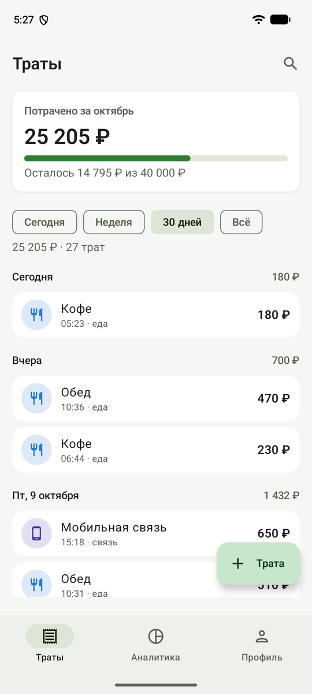
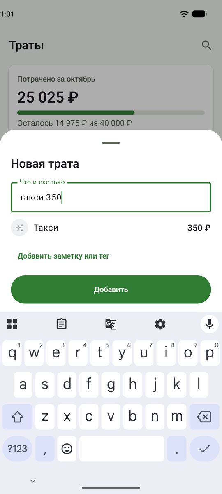
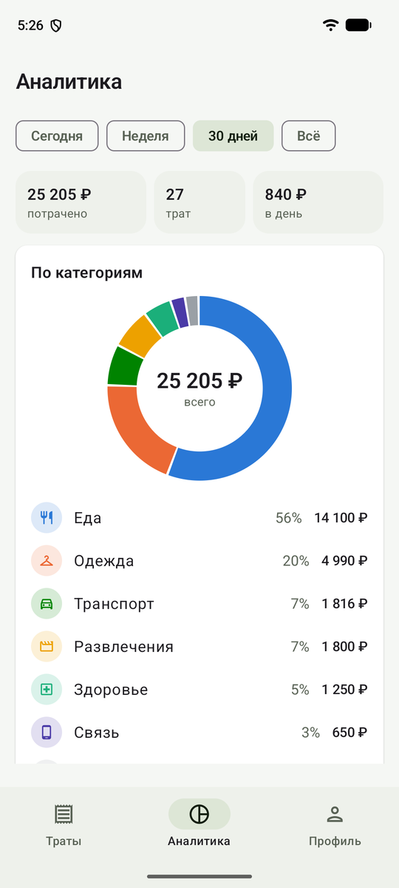
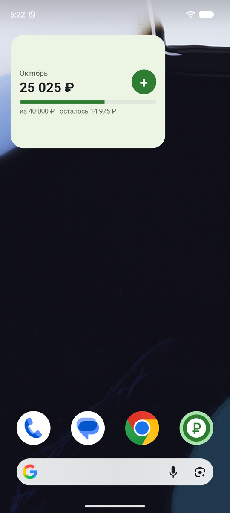
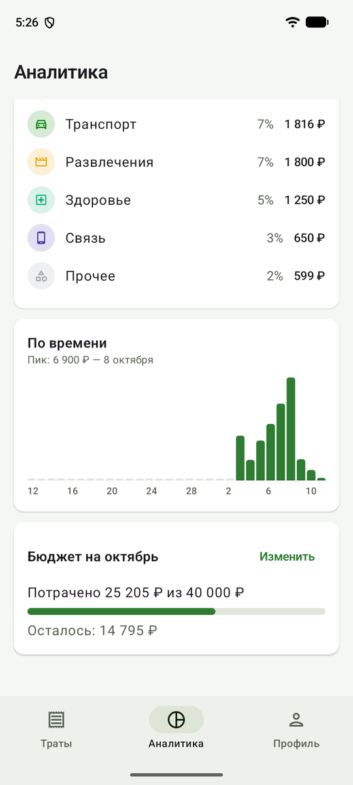
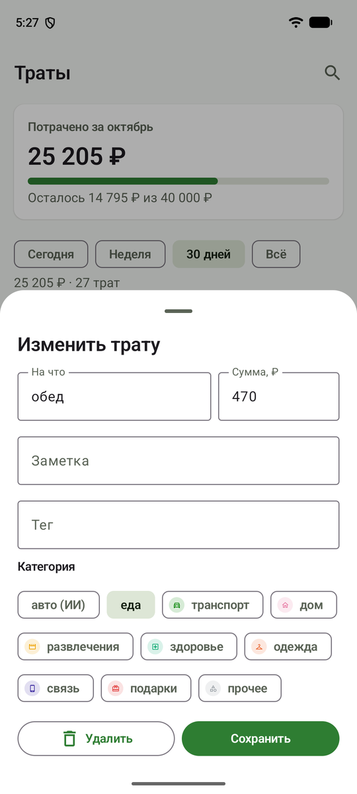
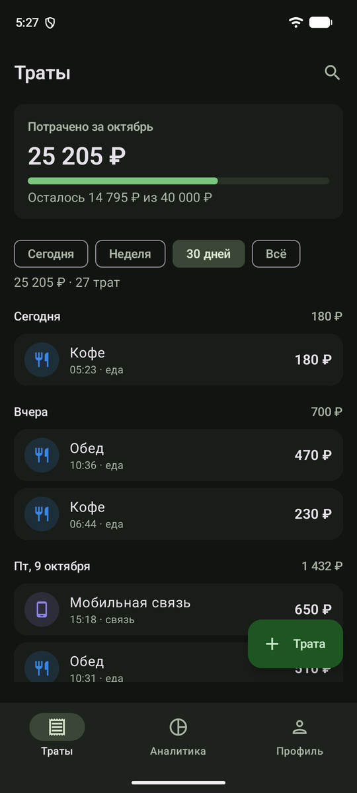
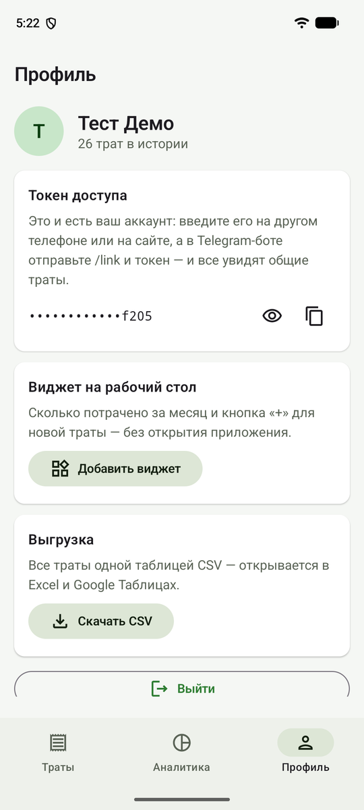

# Expenses — учёт личных расходов

Приложение для учёта расходов **быстрым вводом**. Одна трата заносится в три касания из любого удобного места — и все места видят общие данные, потому что единый источник правды это база на сервере.

Три клиента к одному бэкенду:

- **📱 Android-приложение** (Kotlin + Jetpack Compose);
- **🤖 Telegram-бот** — пишешь «кофе 200», трата записана;
- **🌐 Веб-страница** — её отдаёт сам бэкенд, форма + список прямо в браузере.

Проект показывает полноценную **клиент-серверную архитектуру**: несколько клиентов, REST API, база данных, авторизация и даже категоризация трат через ИИ.

**Попробовать:** https://vihreaexpenses.duckdns.org:34443 · [скачать APK и бот](https://vihreaexpenses.duckdns.org:34443/install.html) · [@Expensesvihrea_bot](https://t.me/Expensesvihrea_bot)

| Траты | Быстрый ввод | Аналитика | Виджет |
|:---:|:---:|:---:|:---:|
|  |  |  |  |
| **График и бюджет** | **Правка траты** | **Тёмная тема** | **Профиль** |
|  |  |  |  |

<sub>Скриншоты — release-сборка 2.0.0 на эмуляторе Pixel 7 (Android 17) с боевым сервером, демо-аккаунт.</sub>

## Возможности

- **Быстрый ввод**: строка «такси до дома 350» разбирается в трату (последнее слово — сумма, остальное — категория).
- **Общие данные**: добавил в приложении — видно боту и на сайте, и наоборот.
- **Аккаунты (мультипользовательские)**: каждый входит по своему токену и видит только свои траты. Аккаунт можно создать в приложении/на сайте или получить у бота; бот и приложение связываются командой `/link`.
- **ИИ-категоризация**: обобщённая категория («булочка» → «еда») проставляется в фоне через [Groq](https://groq.com); аналитика группируется по ней.
- **Аналитика**: кольцевая диаграмма «сколько на что» по категориям + **график трат по времени** (по дням/месяцам) + переключатель периода (сегодня / неделя / месяц / всё).
- **Бюджет на месяц**: лимит с индикатором «потрачено X из Y, осталось Z»; перерасход подсвечивается.
- **Экспорт в CSV**: выгрузка всех трат в файл-таблицу (открывается в Excel/Google Таблицах) — из приложения и с сайта.
- **Авторизация**: доступ к API закрыт bearer-токеном; токен = аккаунт (см. выше).
- **Офлайн**: в приложении всё работает без сети — траты уходят на сервер сами, когда сеть появится (WorkManager), даже если приложение закрыто.
- **Виджет и ярлык**: на рабочем столе — сколько потрачено за месяц и кнопка «+»; долгое нажатие на значок — ярлык «Трата».

## Android-приложение 2.0

В 2.0 приложение переписано с «одного экрана на глобальных объектах» на архитектуру, которую
ожидают в продакшене. Логика синхронизации при этом **не менялась** — она переехала в классы,
которые можно тестировать.

```
 UI (Compose)            ViewModel (StateFlow)         Данные                      Сеть / фон
 ─────────────           ──────────────────────        ───────────────────         ───────────────
 ExpensesScreen   ──►    ExpensesViewModel      ──►    ExpensesRepository  ──►     Retrofit (ExpensesApi)
 AnalyticsScreen  ──►    AnalyticsViewModel            ├─ Room (кэш трат, офлайн-очередь)
 ProfileScreen    ──►    ProfileViewModel              └─ DataStore (курсор синка, бюджет)
 LoginScreen      ──►    LoginViewModel         ──►    AuthRepository ─► SessionStore
 Glance-виджет  ◄── WidgetUpdater (подписка на траты/бюджет)          SyncWorker (WorkManager, «есть сеть»)
                         все зависимости собирает Hilt (di/AppModule, RepositoryModule)
```

- **Однонаправленный поток данных (UDF):** экран рисует один неизменяемый `UiState` и отдаёт
  нажатия во ViewModel. Состояние собирается `combine` из потоков (траты из Room, бюджет, период,
  поиск) — сумма за период не может «разъехаться» со списком.
- **Офлайн-first:** экран читает только Room; запись/правка/удаление сначала в локальную базу,
  на сервер — при синхронизации (дельта `GET /api/expenses/changes?since=`, конфликты — по
  `updatedAt`, «кто новее, тот и прав»). Не получилось отправить — задача уходит в
  **WorkManager** с условием «есть сеть».
- **Hilt (DI):** зависимости приходят в конструктор, поэтому в тестах ViewModel получает
  фейковый репозиторий, а репозиторий — поддельный сервер.
- **Общий код с бэкендом:** DTO и парсер «кофе 200» лежат в модуле `shared/` — бот и приложение
  разбирают строку одной и той же функцией; меняешь поле — ломается компиляция обеих сторон.
- **Мелочи, которые видно на демо:** живой предпросмотр «Кофе — 200 ₽» прямо при наборе,
  подсказки частых категорий, свайп-удаление с «Отменить», pull-to-refresh, анимированная
  диаграмма на Canvas, виджет Glance, ярлык, тёмная тема, адаптивный значок (+ монохромный),
  R8 (APK 2,5 МБ вместо 11).
- **Тесты:** 54 юнит-теста (`ExpensesViewModelTest`, `LoginViewModelTest`, `StatsTest`,
  `FormatTest`, `ExpensesRepositorySyncTest` — Room в памяти + поддельный сервер, `ExpenseDaoTest`,
  `ServerWinsTest`) и 5 UI-тестов Compose на эмуляторе; всё гоняется в CI.

> Почему здесь **Retrofit + Room**, а в соседнем проекте [DevLog](https://github.com/vihrea1337/devlog)
> — Ktor Client + SQLDelight? Expenses — чисто Android-клиент, и для него стандартный стек Jetpack
> проще и привычнее команде. DevLog — Kotlin Multiplatform, там сеть и база должны жить в общем
> коде, а Retrofit и Room (до недавнего времени) были только под Android.

## Архитектура

```
┌─────────────┐   ┌─────────────┐   ┌─────────────┐
│  Android    │   │ Telegram    │   │  Браузер    │
│  (Retrofit) │   │  (long-poll)│   │  (fetch)    │
└──────┬──────┘   └──────┬──────┘   └──────┬──────┘
       │ HTTPS + токен   │ Bot API         │ HTTPS + токен
       └─────────────────┼─────────────────┘
                         ▼
              ┌────────────────────┐
              │   Ktor-бэкенд      │  = REST API + Telegram-бот + веб-страница
              │  (один сервис)     │  → классификатор трат (Groq)
              └─────────┬──────────┘
                        ▼
                 ┌────────────┐
                 │ PostgreSQL │  (Exposed)
                 └────────────┘
```

Бэкенд — **один сервис на Ktor**: он же обрабатывает REST API для приложения, он же крутит Telegram-бота, он же отдаёт веб-страницу. Хранилище — **PostgreSQL** (доступ через Exposed). На боевом сервере всё поднято в Docker Compose: Postgres + бэкенд + Caddy (HTTPS).

## Технологии

**Бэкенд:** Kotlin · Ktor · PostgreSQL + Exposed · HikariCP · kotlinx.serialization · ktor-server-auth · Groq API (ИИ)
**Android:** Kotlin · Jetpack Compose (Material 3) · Hilt · Navigation Compose · Room · DataStore · WorkManager · Glance (виджет) · Retrofit + kotlinx.serialization · ViewModel/StateFlow · R8 · JUnit, Robolectric, Turbine, Compose UI Test
**Инфраструктура:** VPS · Docker Compose (Postgres + Ktor + Caddy) · HTTPS (Caddy + DuckDNS) · GitHub Actions (тесты, Docker-смоук, UI-тесты на эмуляторе)

## Структура репозитория

```
Expenses/
├── backend/       — серверная часть (Ktor): API + бот + веб-страница
│   └── src/main/kotlin/io/github/vihrea1337/expenses/
│       ├── Application.kt        — точка входа, маршруты, авторизация, экспорт CSV
│       ├── Expenses.kt/Users.kt/Settings.kt — таблицы (Exposed)
│       ├── ExpenseRepository.kt / UserRepository.kt — работа с БД
│       ├── TelegramBot.kt        — бот (long-polling, команды, меню)
│       ├── Classifier.kt         — ИИ-категоризация (Groq)
│       └── ...DTO
│   ├── src/main/resources/static/index.html — веб-страница
│   └── src/test/                — тесты (парсер, CSV, репозитории на H2)
├── androidApp/    — Android-приложение
│   └── app/src/main/kotlin/io/github/vihrea1337/expenses/android/
│       ├── data/      — репозитории, Retrofit-API, Room, DataStore, сессия
│       ├── di/        — модули Hilt
│       ├── sync/      — SyncWorker (WorkManager)
│       ├── ui/        — экраны: expenses/, analytics/, profile/, login/, navigation/, theme/, common/
│       └── widget/    — виджет Glance
├── shared/        — общий модуль: DTO API и парсер «кофе 200» (бэкенд + Android)
└── docs/          — архитектура, план, деплой, скриншоты
```

## Запуск бэкенда локально

Нужны JDK 21 и запущенный PostgreSQL (например, в Docker):

```bash
docker run -d --name expenses-pg -e POSTGRES_PASSWORD=dev -e POSTGRES_DB=expenses -p 127.0.0.1:5432:5432 postgres:16
```

Из папки `backend/`:

```bash
./gradlew run          # поднимет сервер на http://127.0.0.1:8080
./gradlew buildFatJar  # соберёт один jar для деплоя: build/libs/expenses-backend-all.jar
```

Проверка: `http://127.0.0.1:8080/health` → `{"status":"ok"}`, а `http://127.0.0.1:8080/` — веб-страница.

Секреты (токен бота, ключ Groq) — в `backend/secrets.properties` (в git не попадает):

```
bot.token=<токен от @BotFather>
groq.api.key=<ключ Groq>
```

На боевом сервере те же значения (плюс `API_TOKEN`, `DB_*`) задаются переменными окружения — см. [`docs/deploy.md`](docs/deploy.md).

## Сборка Android-приложения

Открыть папку `androidApp/` в Android Studio и нажать **Run**. Из консоли (JDK 21):

```bash
./gradlew :app:testDebugUnitTest          # юнит-тесты (JVM, без эмулятора)
./gradlew :app:connectedDebugAndroidTest  # UI-тесты Compose (нужен эмулятор/телефон)
./gradlew :app:assembleRelease            # release-APK с R8
./gradlew :app:assembleDebug -Pexpenses.baseUrl=http://10.0.2.2:8080/  # debug против локального сервера
```
 При первом запуске приложение показывает экран входа: можно **войти по токену** (существующий аккаунт) или **создать новый** (по имени — сервер выдаст токен). Токен доступа хранится на устройстве, поэтому файл `androidApp/local.properties` теперь нужен только для пути к Android SDK (`sdk.dir`); прежний ключ `API_TOKEN` для входа больше не требуется.

## Документация

- [`CLAUDE.md`](CLAUDE.md) — краткая ориентировка по проекту.
- [`docs/architecture.md`](docs/architecture.md) — архитектура, принятые решения, глоссарий.
- [`docs/roadmap.md`](docs/roadmap.md) — план по срезам и статус.
- [`docs/deploy.md`](docs/deploy.md) — как развёрнут бэкенд на VPS.
- [`CHANGELOG.md`](CHANGELOG.md) — история версий.
- [`SECURITY.md`](SECURITY.md) — модель доступа, секреты, известные слабые места.
- Страницы для пользователей (отдаёт сам бэкенд, `backend/src/main/resources/static/`):
  `/install.html` — установка, `/privacy.html` — конфиденциальность, `/terms.html` — условия.
- [`docs/backup.md`](docs/backup.md) — бэкапы базы данных (pg_dump, cron).
- [`docs/gost/`](docs/gost/) — формальный пакет документации по ГОСТ 34 (ТЗ, пояснительная
  записка, руководства пользователя и администратора) + `expenses-gost-documentation.docx`
  в корне репозитория для сдачи.

## Приватность

При ИИ-категоризации краткие описания трат отправляются в сторонний сервис Groq. Если это нежелательно — функцию можно не включать (без `GROQ_API_KEY` траты просто остаются без обобщённой категории). Полностью — на странице [`/privacy.html`](https://vihreaexpenses.duckdns.org:34443/privacy.html).

---

Версия 2.0 · pet-проект · лицензия [MIT](LICENSE).
